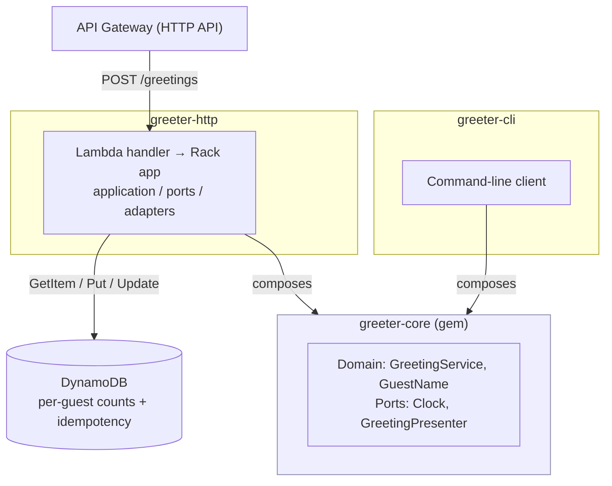

# greeterHQ

**The world's most tested "Hello World".**

Generative AI has made "good enough" code almost free. greeterHQ is a public
experiment to see whether the time saved can be reinvested in practices that
promise high quality and low maintenance, but are often too costly to follow:

1. **Hexagonal Architecture**: one dependency-free core, many adapters (CLI, HTTP, ...)
2. **Full-Stack Testing**: multiple facets of quality checked before every deployment
3. **Live Documentation**: specs as the single source of truth, evolving with the code

**Spec-driven development** (OpenSpec) steers the AI agents and stores the live documentation.

📖 Read the introduction: [Why I'm Building the World's Most Tested "Hello World"](LINK)

## Quick start

```sh
# CORE
gem install greeter-core
# CLI
greeter greet --name Ada
# HTTP
curl -X POST https://API_URL/greetings \
  -H "Idempotency-Key: $(uuidgen)" -d '{"name":"Ada"}'
```

## Architecture


## Repositories
| Repo | What it is | Status |
|--|--|--|
| [greeter-core](https://github.com/greeterhq/greeter-core) | Pure Ruby domain core, no I/O. Published on RubyGems. |   |
| [greeter-cli](https://github.com/greeterhq/greeter-cli) | Command-line client composing greeter-core |  |
| [greeter-http](https://github.com/greeterhq/greeter-http) | AWS Lambda + API Gateway + DynamoDB, idempotent per-guest counts |  |

## Testing strategy
| Layer | Tooling | Status |
|--|--|--|
| Unit (domain) | RSpec, in-memory test doubles | ✅ |
| Behaviour (BDD) | Cucumber / Gherkin | ✅ |
| Static analysis | RuboCop | ✅ |
| Cross-adapter compatibility | Shared specs across CLI and HTTP | 🔜 |
| Contract | Pact | 🔜 |
| Security | OWASP ZAP, dependency scanning | 🔜 |
| Performance | k6 against SLOs | 🔜 |
| Observability | OpenTelemetry | 🔜 |

## Live documentation
Specs live in [openspec/](LINK). Flow:
stakeholder + requirements agent → spec → code-generating agents → tests → CI.

## Follow along
Weekly posts on what I built, what broke and what I learned:
[LinkedIn](LINK) · Built by Adam Bonsu, SC-cleared Test Lead.