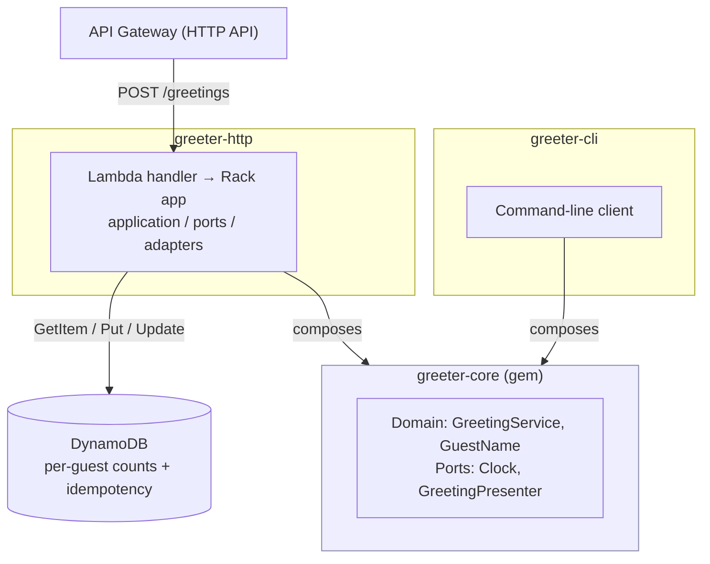

# greeterHQ

A small, deliberately over-engineered **greeting service**, built as a hexagonal
Ruby system split across three repositories: a pure domain core, a CLI client,
and an HTTP service on AWS serverless infrastructure.

The domain is intentionally tiny — "greet a guest, count the greetings" — so the
focus is on clean architecture: a dependency-free core that knows nothing about
I/O, composed by adapters that handle the CLI, HTTP, persistence, and AWS.

## Architecture

### How it fits together

- **greeter-core** is the dependency. The CLI and the HTTP service each
  *compose* it (never reopen, subclass, or vendor it) — hexagonal architecture
  with the core at the centre and all I/O pushed out to adapters.
- **greeter-http** adds the HTTP boundary (API Gateway → Lambda → Rack), a
  per-guest greeting counter in DynamoDB, and idempotent writes keyed by a
  client `Idempotency-Key`.
- **greeter-cli** provides a command-line way to exercise the same domain.

## Repositories

| Repo | What it is |
| --- | --- |
| [**greeter-core**](https://github.com/greeterhq/greeter-core) | The domain core — pure Ruby, no I/O. Published as a gem on [rubygems.org](https://rubygems.org/gems/greeter-core). |
| [**greeter-cli**](https://github.com/greeterhq/greeter-cli) | Command-line client that composes `greeter-core`. |
| [**greeter-http**](https://github.com/greeterhq/greeter-http) | HTTP service: AWS Lambda + API Gateway + DynamoDB, idempotent per-guest greeting counts. |

## Tech

Ruby 3.3 · Hexagonal architecture · AWS Lambda / API Gateway / DynamoDB (SAM) ·
RSpec + Cucumber · OpenSpec-driven · GitHub Actions CI/CD.
